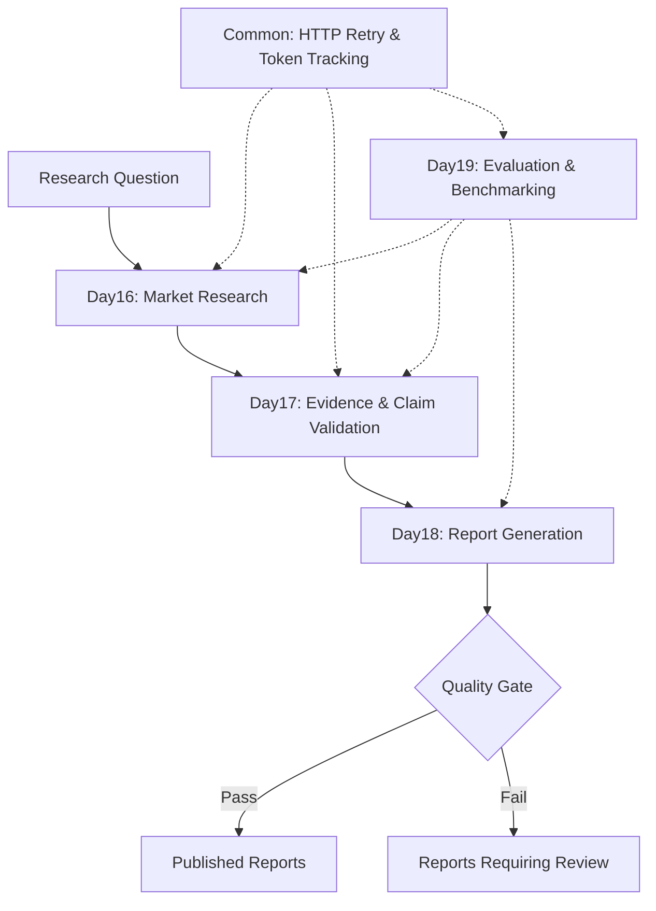

# AI Agent Engineering: RWA Market Research Agent

A Python-based AI Agent project for researching Real-World Asset (RWA) protocols, validating evidence, generating structured research reports, and evaluating execution performance.

This repository documents a 20-day hands-on AI Agent engineering learning journey.

## Project Overview

The project demonstrates an end-to-end RWA market research workflow:

1. **Market Research** — Retrieve live RWA protocol data and execute a research pipeline.
2. **Quality Validation** — Evaluate evidence coverage, claim completeness, and research quality.
3. **Report Generation** — Generate structured Markdown research reports.
4. **Quality Gate** — Separate publishable reports from reports requiring review.
5. **Evaluation & Benchmarking** — Track execution success, latency, token usage, and estimated API costs.


## System Architecture



## Tech Stack

- **Language:** Python
- **LLM API:** OpenAI Responses API
- **Data Sources:** RWA market data APIs
- **Data Validation:** Pydantic
- **HTTP Client:** Requests
- **API Framework:** FastAPI (used in earlier learning modules)
- **Version Control:** Git and GitHub

## Core Modules

| Module | Responsibility |
|---|---|
| `day16/` | RWA market research and data retrieval |
| `day17/` | Evidence validation and research quality evaluation |
| `day18/` | Research report generation and quality-gated publishing |
| `day19/` | Agent evaluation, benchmarking, token tracking, and cost estimation |
| `common/` | Shared HTTP retry, token tracking, and cost utilities |

## Report Publishing

Generated reports are stored according to the quality gate result:

- `day18/reports/published/` — Reports that pass the configured quality checks.
- `day18/reports/review/` — Reports that require further review.

Reports requiring review include a warning and the reasons provided by the quality gate.

## Project Status

- Day 01–19: Core learning and implementation stages completed.
- Day 20: Documentation, demonstration, and project portfolio preparation in progress.


## Quick Start

### 1. Clone the repository

```bash
git clone https://github.com/Kaisa111/ai-agent-20days.git
cd ai-agent-20days
```

### 2. Create a virtual environment

Python 3.12 is recommended.

```bash
python -m venv .venv
```

Activate the environment on Windows PowerShell:

```powershell
.\.venv\Scripts\Activate.ps1
```

### 3. Install dependencies

```bash
python -m pip install -r requirements.txt
```

### 4. Configure the OpenAI API key

Create a `.env` file in the project root:

```env
OPENAI_API_KEY=your_openai_api_key_here
```

Never commit real API keys to GitHub.

### 5. Run the RWA Research Agent

```bash
python -m day18.run_report --question "目前主要RWA协议的TVL是多少？" --limit 3
```

The pipeline retrieves market data, validates research
quality, generates a structured report, and applies a
quality gate before publishing.

Reports are saved to:

- `day18/reports/published/`
- `day18/reports/review/`

### 6. Run Agent Benchmark

```bash
python -m day19.run_benchmark --runs 1 --limit 3
```

The benchmark records:

- Execution success rate
- Average and P95 latency
- Evidence coverage
- Claim completeness
- Input and output token usage
- Estimated OpenAI API cost

Benchmark results are saved as JSON files in:

`day19/results/`

**Note:** Running the research agent or benchmark may
make paid API requests. External market data services
must also be reachable.

## Disclaimer

This project is intended for educational and engineering demonstration purposes. Market research outputs may contain errors or outdated information and should not be treated as investment advice.